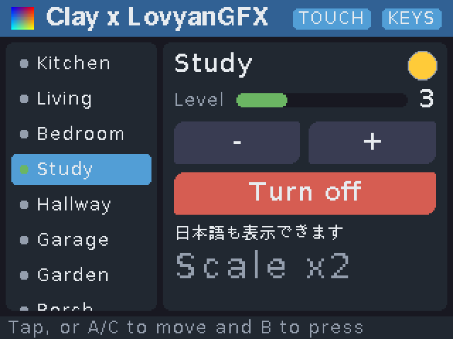

# Clay LovyanGFX Renderer

[日本語](README.ja.md)

A renderer that draws the layouts of [Clay](https://github.com/nicbarker/clay) with [LovyanGFX](https://github.com/lovyan03/LovyanGFX). It shows UIs built with Clay on the LCDs of ESP32 boards, M5Stack among them.

- Supports every Clay render command (rectangles, borders, text, images, scissors, overlay colors, custom elements)
- Rounded corners can have a different radius for each corner, and borders a different width for each side
- Text is drawn with LovyanGFX fonts (GFXfont, U8g2, BDF, VLW and more). The built in Japanese fonts work as they are, and text is scaled up by whole numbers according to `fontSize`
- Works with a touch panel, with hardware buttons, or with both
- Draws into a small sprite holding a band of the screen and pushes it to the display band by band, so it does not flicker even on boards without PSRAM
- Skips pushing to the display when a frame draws the same as the previous one

Here is a screenshot of `example/demo`.



## Quick start

These are the steps for starting to use this library in your own project. They cover checking what you need, installing the dependencies, and running your first program.

### Requirements

- **Board**: an ESP32 board with a display that LovyanGFX supports. Tested on M5Stack Basic, Core2 and CoreS3.
- **Arduino core 3.x for ESP32**: Clay needs C++20. Core 2.x (gcc 8) cannot be set to C++20, so builds fail with it.
- **Dependencies**: [Clay](https://github.com/nicbarker/clay) (the single header `clay.h`) and [LovyanGFX](https://github.com/lovyan03/LovyanGFX) 1.2 or later.

### Installing the dependencies

Pick one of the following, matching the build environment you use. The program is the same whichever you choose.

#### With Nix

If you use Nix Flakes, add this repository to the inputs of your flake. The versions of Clay and LovyanGFX this repository was tested with can be taken from that input too. On NixOS, an `arduino-cli` wrapped in an FHS environment, so that the ESP32 toolchains run, is also available.

```nix
{
  inputs = {
    nixpkgs.url = "github:NixOS/nixpkgs/nixos-unstable";
    clay-lgfx = {
      url = "github:kakkun61/clay-lgfx-renderer";
      inputs.nixpkgs.follows = "nixpkgs";
    };
  };

  outputs =
    { nixpkgs, clay-lgfx, ... }:
    let
      system = "x86_64-linux";
      pkgs = import nixpkgs { inherit system; };
    in
    {
      devShells.${system}.default = pkgs.mkShell {
        packages = [ clay-lgfx.packages.${system}.arduino-cli ];
        # This library, Clay and LovyanGFX (the versions it was tested with)
        shellHook = ''
          export LIBRARY_OPTS="--library ${clay-lgfx} --library ${clay-lgfx.inputs.lovyangfx} --library ${clay-lgfx.inputs.clay}"
        '';
      };
    };
}
```

Build in the shell `nix develop` opens:

```console
arduino-cli core update-index && arduino-cli core install esp32:esp32   # First time only
arduino-cli compile --fqbn esp32:esp32:m5stack_core $LIBRARY_OPTS my_sketch
arduino-cli upload --fqbn esp32:esp32:m5stack_core --port /dev/ttyUSB0 my_sketch
```

#### With Arduino CLI

Install LovyanGFX with the library manager. Get Clay and this library with git and pass their locations with `--library`. With the Arduino IDE, you can instead put the two directories in the `libraries` folder of your sketchbook.

```console
arduino-cli core update-index && arduino-cli core install esp32:esp32   # First time only
arduino-cli lib install LovyanGFX
git clone https://github.com/nicbarker/clay.git
git clone https://github.com/kakkun61/clay-lgfx-renderer.git

arduino-cli compile --fqbn esp32:esp32:m5stack_core --library clay-lgfx-renderer --library clay my_sketch
```

The FQBN is `esp32:esp32:m5stack_core2` for Core2 and `esp32:esp32:m5stack_cores3` for CoreS3.

#### With PlatformIO

LovyanGFX is fetched from the registry automatically, following this library's manifest (`library.json`). Clay is not in the PlatformIO registry, and naming its Git repository as a dependency fails because the renderers for other libraries get compiled too, so put the single header `clay.h` in the `include/` directory of your project.

```console
curl -L -o include/clay.h https://raw.githubusercontent.com/nicbarker/clay/main/clay.h
```

The default `espressif32` platform of PlatformIO ships Arduino core 2.x, so use the [pioarduino](https://github.com/pioarduino/platform-espressif32) platform, which uses Arduino core 3.x. For an M5Stack Basic, `platformio.ini` looks like this:

```ini
[env:m5stack-core]
platform = https://github.com/pioarduino/platform-espressif32/releases/download/stable/platform-espressif32.zip
board = m5stack-core-esp32
; Arduino core 3.x renamed this board's variant
board_build.variant = m5stack_core
framework = arduino
; This library (not in the registry, so given by its Git URL)
lib_deps = https://github.com/kakkun61/clay-lgfx-renderer.git
; Let libraries see clay.h in include/ too
build_flags = -isystem include
```

### Your first program

A program that does nothing but count up when a button is pressed. Tap the button on boards with a touch panel; on an M5Stack Basic, move the focus to it with buttons A and C and select it with button B. The same program is `example/minimal/minimal.ino`, which `make esp32 SKETCH=example/minimal` builds. Save it as `my_sketch/my_sketch.ino` for Arduino CLI, or as `src/main.ino` for PlatformIO.

```cpp
// The smallest useful program: a counter and a button that increments it.
//
// It runs on any ESP32 board LovyanGFX detects. The button can be tapped on a
// touch panel, or, on an original M5Stack, selected with buttons A and C and
// pressed with button B.

#define LGFX_AUTODETECT
#include <LGFX_AUTODETECT.hpp>
#include <LovyanGFX.hpp>

// Clay is a single header library: exactly one source file compiles its
// implementation, and this sketch is that file.
#define CLAY_IMPLEMENTATION
#include <clay.h>

#include <ClayLGFX.hpp>

// Arduino calls setup() and loop() without arguments, so the objects they
// share have to live at file scope.
static LGFX display;
static clay_lgfx::FontTable fontTable;
static clay_lgfx::Renderer renderer(fontTable);
static clay_lgfx::BandedPresenter presenter(display, renderer);
static clay_lgfx::InputController input;
static clay_lgfx::GpioButtons buttons({ 39, 38, 37 });  // Buttons A, B and C of an original M5Stack.
static uint32_t lastMillis = 0;
static int count = 0;
static char countText[24];

static void printClayError(Clay_ErrorData error) {
  Serial.printf("clay: %.*s\n", static_cast<int>(error.errorText.length), error.errorText.chars);
}

void setup() {
  Serial.begin(115200);
  display.init();

  // Any LovyanGFX font works. Font 0 is also used by Clay's debug view.
  fontTable.set(0, &lgfx::fonts::DejaVu18);

  // Clay's defaults are sized for desktops; a small screen needs far fewer elements.
  Clay_SetMaxElementCount(64);
  Clay_SetMaxMeasureTextCacheWordCount(128);
  const uint32_t size = Clay_MinMemorySize();
  const Clay_Arena arena = Clay_CreateArenaWithCapacityAndMemory(size, malloc(size));
  Clay_Initialize(arena,
                  Clay_Dimensions{ static_cast<float>(display.width()), static_cast<float>(display.height()) },
                  Clay_ErrorHandler{ printClayError, nullptr });
  fontTable.attach();

  // Draw through a buffer of 40 rows, so the screen never flickers.
  presenter.begin(40);
  presenter.setClearColor(Clay_Color{ 20, 24, 32, 255 });

  // Use whatever input the board has: a touch panel, buttons, or both.
  if (display.touch()) input.setTouchDisplay(&display);
  if (display.getBoard() == lgfx::board_t::board_M5Stack) {
    buttons.begin();
    input.setButtons(&clay_lgfx::GpioButtons::reader, &buttons);
  }
  lastMillis = millis();
}

void loop() {
  const uint32_t now = millis();
  const float deltaTime = static_cast<float>(now - lastMillis) / 1000.0f;
  lastMillis = now;

  input.update(deltaTime);  // Always before Clay_BeginLayout().
  Clay_BeginLayout();

  snprintf(countText, sizeof(countText), "Count: %d", count);
  CLAY(CLAY_ID("Root"),
       { .layout = { .sizing = { CLAY_SIZING_GROW(0), CLAY_SIZING_GROW(0) },
                     .childGap = 16,
                     .childAlignment = { CLAY_ALIGN_X_CENTER, CLAY_ALIGN_Y_CENTER },
                     .layoutDirection = CLAY_TOP_TO_BOTTOM } }) {
    CLAY_TEXT((Clay_String{ false, static_cast<int32_t>(strlen(countText)), countText }),
              CLAY_TEXT_CONFIG({ .textColor = { 255, 255, 255, 255 } }));

    // focusable() lets the buttons reach this element; it returns whether to show the focus.
    const bool focused = input.focusable(CLAY_ID("Button"));
    CLAY(CLAY_ID("Button"),
         { .layout = { .padding = { 24, 24, 10, 10 } },
           .backgroundColor = Clay_Hovered() ? Clay_Color{ 86, 156, 214, 255 } : Clay_Color{ 56, 62, 80, 255 },
           .cornerRadius = CLAY_CORNER_RADIUS(8),
           .border = { .color = { 250, 200, 60, 255 },
                       .width = CLAY_BORDER_OUTSIDE(static_cast<uint16_t>(focused ? 2 : 0)) } }) {
      // A click is a release over the element.
      if (Clay_Hovered() && Clay_GetPointerState().state == CLAY_POINTER_DATA_RELEASED_THIS_FRAME) ++count;
      CLAY_TEXT(CLAY_STRING("Press me"), CLAY_TEXT_CONFIG({ .textColor = { 255, 255, 255, 255 } }));
    }
  }

  presenter.present(Clay_EndLayout(deltaTime));
  delay(5);
}
```

This is how the program flows:

1. `setup()` registers the fonts, initializes Clay, and prepares drawing and input. Clay's default limit on the number of elements is too large, being meant for desktops, so it is lowered before memory is allocated.
2. Every frame, `loop()` hands the input to Clay with `input.update()`, builds the screen with `CLAY(...)` between `Clay_BeginLayout()` and `Clay_EndLayout()`, and draws it with `presenter.present()`.
3. To react to the button, check `Clay_Hovered()` and `Clay_GetPointerState()` inside the element. To make it usable with hardware buttons too, make the element a focus target with `input.focusable()`.

### What to read next

- [Usage](#usage): what each part does
- [Fonts](#fonts): using Japanese and proportional fonts
- [Input](#input): how touch panels and buttons are handled
- `example/demo/`: a somewhat larger demo using lists, scrolling, images, custom elements and more
- [Reference](https://kakkun61.github.io/clay-lgfx-renderer/): API details

## Usage

The library is made of the following parts. [Your first program](#your-first-program) uses all of them.

- **`FontTable`**: maps Clay's `fontId` to LovyanGFX fonts. After `attach()`, Clay measures text with this table.
- **`Renderer`**: draws Clay's render commands onto LovyanGFX displays and sprites.
- **`BandedPresenter`**: splits the screen into bands, draws them into a small sprite and pushes them to the display. It does not flicker, and it skips pushing when a frame is the same as the previous one.
- **`InputController`**: turns touch panel and button input into Clay's pointer.

A frame goes `input.update()`, `Clay_BeginLayout()`, building the screen with `CLAY(...)`, `Clay_EndLayout()`, then `presenter.present()`. Always call `input.update()` before `Clay_BeginLayout()`.

If you do not mind flicker, or want to draw into a sprite of your own, `renderer.render(target, commands)` draws straight onto any `lgfx::LovyanGFX`, display or sprite.

### Fonts

Text is drawn with LovyanGFX fonts. Anything derived from `lgfx::IFont` can be registered in a `FontTable`, and decoding the font formats and drawing the characters is left to LovyanGFX. This library contains no font data.

- **GFXfont**: built in fonts such as `fonts::FreeSans9pt7b` and `fonts::DejaVu12`, and fonts in Adafruit GFX format (made with [shapofont](https://github.com/shapoco/shapofont), Adafruit's fontconvert and so on).
- **U8g2**: built in Japanese fonts such as `fonts::lgfxJapanGothic_12` and `fonts::lgfxJapanMincho_16`.
- **BDF** (such as `fonts::efont`), **VLW** loaded at run time, and every other format LovyanGFX handles.

```cpp
fontTable.set(0, &fonts::DejaVu12);
fontTable.set(1, &fonts::lgfxJapanGothic_12);   // Japanese
fontTable.set(2, &fonts::FreeSans9pt7b, 0);     // Draw nothing for characters the font lacks
```

If you need a font of your own, derive from `lgfx::IFont` and implement `getDefaultMetric()`, `updateFontMetric()` and `drawChar()`. How glyphs are stored, how characters map to glyphs and how advances are decided is up to you.

The width of text is the sum of the advances `updateFontMetric()` gives for each character. Drawing goes through `drawChar()`, positioned the same way as LovyanGFX's `drawString()`. Unit tests check that the measured widths and the drawn pixels match `drawString()` exactly. However, since Clay adds up widths measured word by word, the part of the last character's drawing that sticks out beyond its advance is not counted in the width (`textWidth()` counts it).

Characters the font lacks are drawn as the character given at registration (`?` by default). If that is missing too, nothing is drawn and no width is taken. LovyanGFX fonts only go up to U+FFFF, so characters beyond it (most emoji) are treated the same way.

With a `fontSize` of 0, text is drawn at its own size; otherwise it is scaled by the largest whole number that keeps the font's text height from exceeding `fontSize` (at least 1). Text is read as UTF-8.

Clay caches text measurements. When you replace a font with `FontTable::set()` while running, call `Clay_ResetMeasureTextCache()`.

### Input

`InputController` turns touch panels and buttons into Clay's pointer. Applications react to input as usual, with `Clay_Hovered()`, `Clay_PointerOver()` and `Clay_GetPointerState()`.

- **Touch panel**: the touched point becomes the pointer. Dragging scrolls scroll containers, and lifting the finger after a drag does not count as a tap.
- **Buttons**: three buttons, previous, select and next, move the focus, and the select button clicks the center of the focused element. Elements that can take the focus are declared with `input.focusable(id)` during layout. It returns whether the focus ring should be drawn. While an element has the focus, the pointer sits on it, so hover effects double as a focus indicator.
- **Core2 touch buttons**: with `setTouchButtonZone(true)`, touches beyond the bottom of the screen are treated as three buttons.

Buttons are read through a function pointer, `ButtonReader`, so you can pass the bundled `GpioButtons` for buttons wired to GPIO, or a function of your own for buttons behind M5Unified or an I/O expander. If the board has no touch panel, just do not call `setTouchDisplay()`; if it has no buttons, do not call `setButtons()`.

## About global state

The library itself has no global variables. The font table, the renderer and the input state all live in objects, and callbacks to Clay pass the object itself through `userData` rather than through a global.

Two things cannot be avoided, though:

- **Clay's "current context"**: Clay's API is designed to work implicitly on a global context set with `Clay_SetCurrentContext()`. `FontTable::attach()` and `InputController::update()` act on whatever context is current at the time. When using several contexts, switch with `Clay_SetCurrentContext()` before calling them (the demo's `DemoApp::frame()` does so).
- **Arduino's entry points**: Arduino's `setup()` and `loop()` take no arguments, so the display and application objects they share can only live in file scope static variables (`example/demo/demo.ino`). From there on, everything is passed through constructors and arguments. The SDL version (`example/demo/sim_main.cpp`), which owns its main loop, keeps the same objects on the stack.

## Developing this repository

From here on, the text is for those working on this repository itself. If you only use the library, the [quick start](#quick-start) is enough.

Package management and the development environment use Nix Flakes. The sources of Clay and LovyanGFX are pinned in `flake.lock` too.

```console
nix develop          # Enter a shell with the toolchain
make test            # Unit tests
make all             # Build everything, ESP32 sketches included (after make esp32-setup)
make run-sim         # Run the demo in the SDL simulator
```

The `nix develop` shell sets `CLAY_DIR` and `LOVYANGFX_DIR`, which the Makefile uses to find the sources. Outside the development shell, pass these two yourself.

If the Arduino core for ESP32 is installed, the locations of its headers are set too, in `ARDUINO_ESP32_DIR` (the core) and `ARDUINO_ESP32_SDK_DIR` (the ESP-IDF SDK). arduino-cli downloads the core at run time, so every time the shell starts, it looks for the newest installed version. With the VS Code C/C++ extension, writing paths such as `${env:ARDUINO_ESP32_DIR}/cores/esp32` in `includePath` of `.vscode/c_cpp_properties.json` makes `Arduino.h` visible to the editor's completion and error checking. So that VS Code inherits the environment variables of the development shell, use the direnv extension or start it with `code .` from a shell opened with `nix develop`. When Arduino symbols such as `Serial` show up as undefined in an `.ino`, it is because these headers are not visible. If the core is not installed yet, install it with `make esp32-setup`, enter the development shell again, and reload IntelliSense.

These are available as well:

```console
nix build            # Build the simulator, the documentation and a test run (under result/)
nix build .#doc      # Build only the documentation (result/html)
nix flake check      # Run the unit tests, the format check and the spell check
nix fmt              # Format every file with treefmt (nixfmt, clang-format)
```

Spelling is checked with cspell-nix. To add words to the dictionary, add them to cspell.yaml.

### Flashing a board

Builds for real boards use arduino-cli. The Arduino core for ESP32 uses prebuilt toolchains downloaded at run time, so the `arduino-cli` of the development shell is wrapped in an FHS environment to work on NixOS as well.

```console
make esp32-setup                                        # First time only: install the ESP32 core
make esp32                                              # Build for M5Stack Basic
make esp32 SKETCH=example/minimal                       # Build the minimal sketch
make esp32-all                                          # Build every sketch for every supported board
make upload PORT=/dev/ttyUSB0                           # Build and flash
make upload FQBN=esp32:esp32:m5stack_core2 PORT=/dev/ttyACM0
make monitor PORT=/dev/ttyUSB0                          # Serial monitor
```

Builds for M5Stack Basic (`m5stack_core`), Core2 (`m5stack_core2`) and CoreS3 (`m5stack_cores3`) are confirmed to work.

The version of the Arduino core for ESP32 is pinned by `ESP32_CORE_VERSION` in the Makefile (currently 3.3.12). `make esp32-setup` installs that version, and CI builds with it. To move to a newer version, change the value and run `make esp32-setup` again.

## Directory layout

```
src/
  ClayLGFX.hpp            Header that brings in everything
  clay_lgfx/
    renderer.hpp/.cpp     Render command handling and pushing in bands
    font.hpp/.cpp         Text measurement, substitute characters, UTF-8 decoding
    font_table.hpp/.cpp   Mapping from fontId to fonts
    input.hpp/.cpp        Touch and button input
    geometry.hpp/.cpp     Rasterizing rounded corners and borders
test/                     Unit tests (linked with LovyanGFX, checked by drawing into sprites)
example/demo/             Demo running on boards and in the simulator
example/minimal/          The first program of the quick start
```

The root of the repository is both an Arduino library (`library.properties`) and a PlatformIO library (`library.json`), so it can be given as it is to arduino-cli's `--library` and to PlatformIO's `lib_deps`.

## Limitations

- Color alpha is only treated as 0 (do not draw) or anything else (draw opaque). Most panels cannot read pixels back, so alpha blending is not possible in general.
- Image corner radii and tint are ignored.
- Glyphs are one bit per pixel. Antialiased fonts and color emoji are not supported.

## License

Apache License 2.0.

Clay is distributed under the zlib license, and LovyanGFX under the FreeBSD license.
